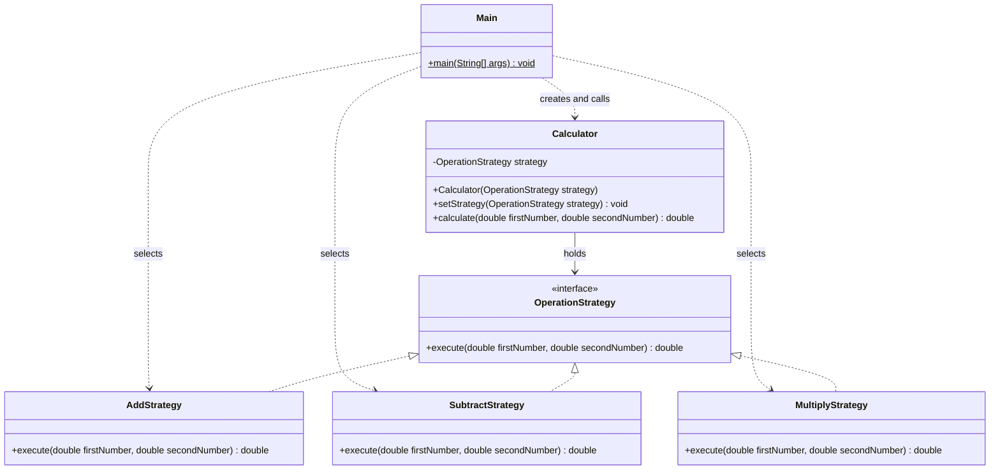

# Assignment 5 Strategy Pattern

**Student:** Adiyat Nurkenuly  
**Group:** SE-2527  
**Topic:** Option B - Calculator  
**Language:** Java 17

## 1 Introduction

This project applies the Strategy pattern to a calculator. Its algorithm family contains addition, subtraction, and multiplication. Each operation implements the same `OperationStrategy` interface. `Calculator` stores the current strategy and delegates calculation to it. `Main` selects the operation and changes it at runtime using `setStrategy`.

The main demonstration uses the same calculator and the numbers 10 and 5. It produces 15.0, 5.0, and 50.0 after switching operations. A separate power example demonstrates how to extend the design.

## 2 UML class diagram

The diagram shows six Java types: five classes and one interface. `Main` is the client, `Calculator` is the context, and the three concrete strategies implement `OperationStrategy`.



The optional `PowerStrategy` also implements `OperationStrategy`. Its separate client, `PowerDemo`, uses the existing `Calculator` without changing the core classes.

## 3 Clean Code principles

### 3.1 Replace operation conditionals with polymorphism

```java
return strategy.execute(firstNumber, secondNumber);
```

This line in `Calculator.calculate` calls the selected implementation. There is no `if`, `switch`, or concrete strategy type check in the context. A new operation does not require another branch.

### 3.2 Use meaningful names

```java
public class SubtractStrategy implements OperationStrategy {
    @Override
    public double execute(double firstNumber, double secondNumber) {
        return firstNumber - secondNumber;
    }
}
```

`SubtractStrategy` states the operation directly. `firstNumber` and `secondNumber` identify the inputs and preserve their order, which matters for subtraction.

### 3.3 Keep one responsibility per class

```java
return firstNumber + secondNumber;
```

This is the complete algorithm in `AddStrategy.execute`. The class only adds numbers. `Main` handles console output and chooses operations; `Calculator` delegates execution. These responsibilities are kept separate.

### 3.4 Depend on an abstraction

```java
private OperationStrategy strategy;

public void setStrategy(OperationStrategy strategy) {
    this.strategy = strategy;
}
```

The context stores an interface, so it does not depend on the internals of addition, subtraction, or multiplication. The private field hides its representation, while the setter allows the client to replace the algorithm at runtime.

### 3.5 Stay open for extension

```java
public class PowerStrategy implements OperationStrategy {
    @Override
    public double execute(double firstNumber, double secondNumber) {
        return Math.pow(firstNumber, secondNumber);
    }
}
```

`PowerStrategy` adds exponentiation. The new `PowerDemo` client selects it with:

```java
calculator.setStrategy(new PowerStrategy());
```

Both files are in `examples`. Adding them requires no changes to `Calculator`, `OperationStrategy`, `Main`, or the existing strategies. The extension runs with 2 and 3 and produces 8.0. Its Git commit adds only these two new files.

These choices follow the responsibility and extensibility principles in *Clean Code*, Chapter 10, and the use of interchangeable algorithms in Lecture 7 and *Head First Design Patterns*.

## 4 Strategy vs State

Strategy fits this problem because the client chooses an arithmetic algorithm and can replace it while the calculator is running. State is used when an object's behavior depends on its internal state and changes as the object moves between states. This calculator has no workflow such as waiting, processing, or finished; it has a client-selected operation. Both patterns can change behavior at runtime, but their purposes differ: algorithm choice for Strategy and state-dependent behavior for State.

## 5 Conclusion

The calculator can switch operations without recreating the context. Adding a new strategy leaves the existing algorithm classes and context unchanged. The tradeoff is more small classes: the core uses six Java files instead of one class with several conditions. For this assignment, those classes make each responsibility and the Strategy pattern easy to see.

The core and extension compiled for Java 17. Their console output matched the expected results. Additional checks covered zero, negative and fractional inputs, and switching strategies on the same calculator.

## 6 GitHub repository

**Repository URL:** https://github.com/nurkenulyadiyat/assignment5-sdp

### References

- Ospanov, A. *Lecture 7: The Strategy Pattern*. Astana IT University. Slides 11, 13, 20, and 23.
- Martin, R. C. (2008). *Clean Code*. Prentice Hall. Chapter 10, especially pp. 138-140 and 149-150.
- Freeman, E., Freeman, E., Sierra, K., & Bates, B. (2004). *Head First Design Patterns*. O'Reilly. Chapter 1, p. 24; Strategy and State comparison, pp. 411 and 419.
